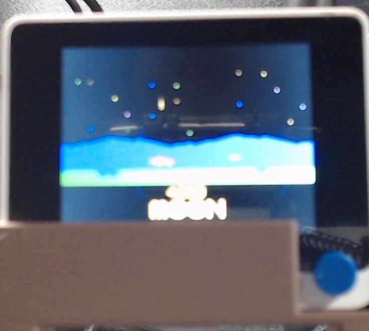
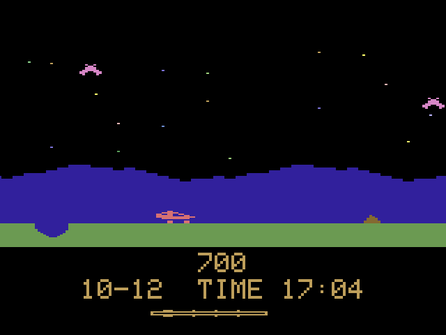
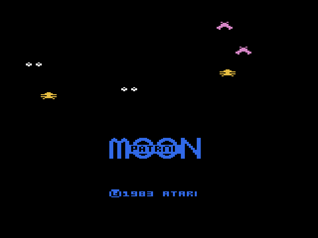
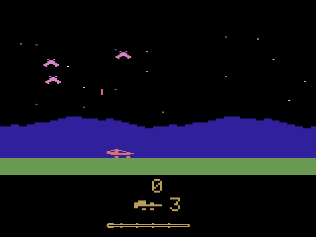
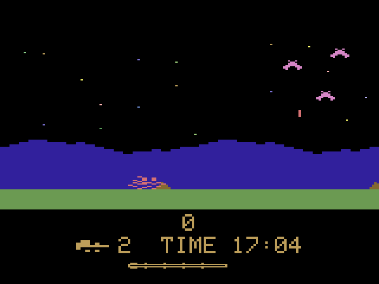
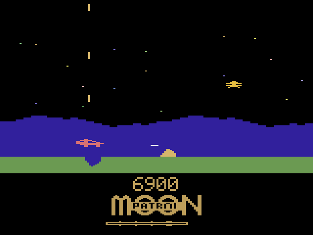
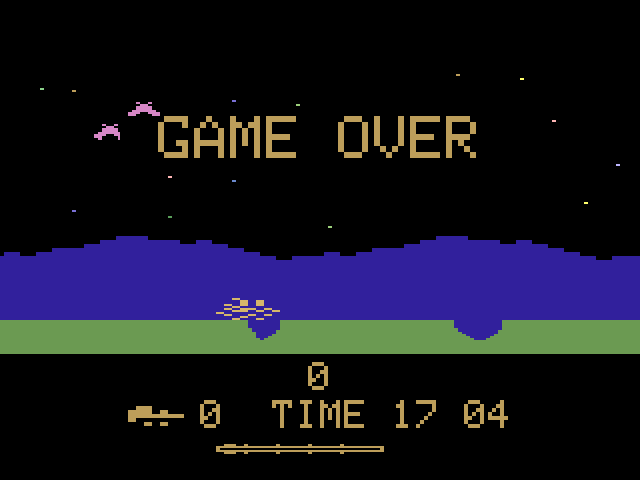
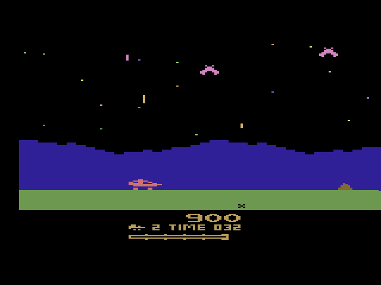
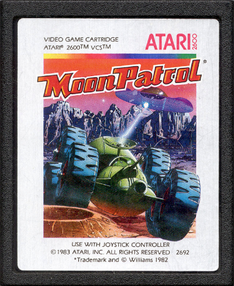

# Wio Moon Patrol

A desk buddy that plays **Moon Patrol** in the style of the Atari 2600 version on a [Seeed Studio Wio Terminal](https://www.seeedstudio.com/Wio-Terminal-p-4509.html). Left alone, it drives itself: the buggy jumps craters, shoots rocks and attackers, and the score climbs under the MOON PATROL logo. Press the top-left button and it's your game: three lives, extra lives every 10,000 points, and attackers that get tougher as you go.

<p align="center">
  
</p>

<sub>The Wio in its stand on the desk. The webcam washes out the panel's colors; the screenshots below are read straight off the display and show the real colors.</sub>

## Screenshots

These are read back pixel by pixel from the Wio's display over USB (`tools/screenshot.py`) and shown here at 2× with no smoothing. Each one links to the exact 320×240 capture.

| | |
|---|---|
| [](docs/screens/autoplay.png) **Autoplay.** The buggy drives itself past a crater and a rock while the HUD shows the score, the MOON PATROL logo, and the course bar. | [](docs/screens/title.png) **Title screen.** The MOON/PATROL logo, traced from the 2600 game, cycles through eight colors over all three attacker types. |
| [](docs/screens/game.png) **In a game.** The logo gives way to the 2600's lives slot: the lives icon and how many are left. | [](docs/screens/crash.png) **Crash.** The buggy breaks apart in a crater and a life is gone. |
| [](docs/screens/later-waves.png) **Later waves.** A saucer, one of the tougher types that join past 3,000 points, with shots flying up and a rock flashing as it's destroyed. | [](docs/screens/game-over.png) **Game over.** Then the title, then back to autoplay. |

The look is matched to a frame of the Atari 2600 game, kept in [`reference/atari-2600.png`](reference/atari-2600.png). Here it is next to the original 1983 cartridge:

<p align="center">
  
  &nbsp;
  
</p>

## How to play

Hold the Wio flat with the power port at the bottom and the blue 5-way switch on the right.

| Control | Action |
|---|---|
| 5-way **right** | Faster: the buggy moves right and the ground scrolls quicker |
| 5-way **left** | Slower: the buggy moves left and the ground scrolls slower |
| 5-way **up** | Jump |
| 5-way **press** | Fire: one shot forward along the ground and one straight up, up to three of each in flight |
| **Top-left** button | From autoplay: title screen, then a new game (press again to skip the title). In a game: back to autoplay, keeping the score. |
| **Top middle** button | Sound on or off |

### Rules

- **Craters** are small or large. Jump them. Landing in one wrecks the buggy.
- **Rocks** sit on the ground. A small rock takes one shot and a boulder takes two. Or jump them.
- **Attackers** fly back and forth, bob up and down, and drop bombs. A bomb that hits the buggy wrecks it, and one that hits the ground ahead can leave a new crater. Upward shots knock bombs out of the air.
- **Attacker types join as you score:** magenta from the start, yellow saucers from 3,000, and white pairs from 6,000. Each later type is faster, swings wider, and bombs more often.
- **Points:** rock 100, attacker 200, cleared crater 100.
- **Lives:** a game starts with 3, gets one more every 10,000 points, and holds at most 5. Losing the last one shows GAME OVER, then the title, then autoplay.

### Autoplay

The buddy boots straight into autoplay, muted. It drives like a player: it speeds up on open road, slows down to line up a crater or rock, shoots what's in front of it and overhead, and dodges falling bombs. Every course, about three minutes, it shows the title screen and starts a fresh run.

### Sound

Sound effects follow the 2600 version: a rising chirp for shots, a falling tone for jumps, a swoop as attackers arrive, a whistle for bombs, a thud when something is destroyed, and a rumble for a crash. Driving is silent, as it is in the 2600 game. With sound on, the Moon Patrol theme's bass line loops underneath and drops out for a moment whenever an effect plays. Autoplay starts muted, a new game turns sound on, and the top middle button toggles it.

## Build and flash

Needs [PlatformIO](https://platformio.org/) (`python3 -m platformio`) and Python 3 with `pyserial` and `Pillow`.

```bash
python3 -m platformio run
python3 tools/flash_uf2.py
```

`tools/flash_uf2.py` resets the Wio into its UF2 bootloader and copies the firmware onto the `Arduino` drive that appears. Set `WIO_PORT` if your serial port isn't `/dev/cu.usbmodem124301`. If the drive never appears, double-tap the Wio's reset slider and run it again.

### Tools

| Script | What it does |
|---|---|
| `tools/flash_uf2.py` | Flashes the build through the UF2 bootloader |
| `tools/screenshot.py out.png` | Saves the Wio's screen as a PNG, read back from the display |
| `tools/midi_to_theme.py file.mid` | Regenerates `src/theme.h` from a MIDI file |

### Serial

At 115200 baud the firmware prints an event line for everything that happens (`JUMP`, `SHOT`, `ROCK 100`, `ATTACKER 200`, `HOLE 100`, `CRASH` with `BY HOLE`/`BY ROCK`/`BY BOMB`, `LIVES n`, `SCORE n`, …). It also accepts these lines:

| Line | Effect |
|---|---|
| `D` | Send the screen contents (used by `tools/screenshot.py`) |
| `I` + letters | Press controls: `R`/`L` hold right/left briefly, `U` jump, `P` fire, `C` top-left button, `S` sound button. Example: `IC` |

## How it's built

- **Hardware:** Seeed Wio Terminal (ATSAMD51P19, 320×240 ILI9341 display, 5-way switch, three top buttons, piezo buzzer).
- **Graphics:** an 8-bit indexed framebuffer in the 2600 palette. Only the rows that change each frame are sent to the display, which keeps it at 30 FPS. Every sprite is cut pixel for pixel from the reference frame or traced from gameplay video: the buggy and its wheel and jump frames, the three attacker types, rocks, craters, crash debris, the lives icon, and the title logo.
- **Music:** the bass line from a Moon Patrol MIDI, moved up two octaves so the piezo can play it, stored as a 230-note table in `src/theme.h`.

The full build log, with each milestone's tests and the decisions behind them, is in [`pickupandgo.md`](pickupandgo.md).

## Sources and references

- **Hardware:** [Seeed Studio Wio Terminal](https://www.seeedstudio.com/Wio-Terminal-p-4509.html)
- **Look, motion, and sound effects:** [Moon Patrol - Atari 2600 (1080p@60fps)](https://www.youtube.com/watch?v=vGFMsMGQNuo) by Gen X Classic Gaming. The title screen, sprite shapes, crater and debris shapes, jump arc, scoring, and the pitch of each sound effect were measured from this video.
- **Cartridge:** photo of the original Atari 2600 Moon Patrol cartridge (Atari, 1983), supplied by the project owner.
- **Reference frame:** a 320×240 Atari 2600 frame, [`reference/atari-2600.png`](reference/atari-2600.png), the source of the palette, buggy, attacker, rock, hill, stars, and HUD layout.
- **Game rules:** [NiccoloBalestrieri/MoonPatrol](https://github.com/NiccoloBalestrieri/MoonPatrol), a 2019 University of Parma Python version. Its rules were reimplemented here; none of its code or art is used.
- **Arcade behavior:** [Computer Archeology: Moon Patrol](https://computerarcheology.com/Arcade/MoonPatrol/), used for how the arcade buggy, attract mode, and craters behave.
- **Theme music:** [Moon Patrol MIDI on VGMusic](https://www.vgmusic.com/file/688104ae3cafca92ac596b7eff54abd9.html). Its bass line is the theme the buzzer plays.
- **Library:** Seeed_Arduino_LCD, bundled with the Seeed SAMD board package.
- [General Sprites from The Spriters Resource](https://www.spriters-resource.com/arcade/moonpatrol/asset/106392/) was considered for the buggy but could not be downloaded, so the 2600 sprites were used instead.

Moon Patrol was created by Irem (1982) and published in US arcades by Williams; the cartridge reads "Trademark and © Williams 1982". The Atari 2600 version is © 1983 Atari, Inc. This is a personal fan project, not affiliated with or endorsed by any of them.

## Collaborators

- [@jeaimehp](https://github.com/jeaimehp): project owner, design direction, and on-device testing
- **Grok** (xAI), working through **Cursor**
- **Claude Code** (Anthropic)
